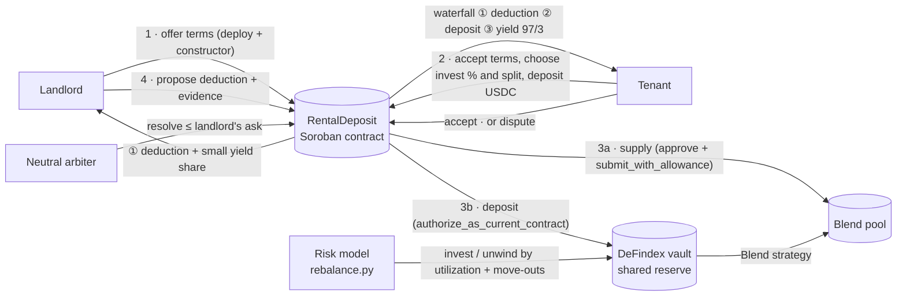
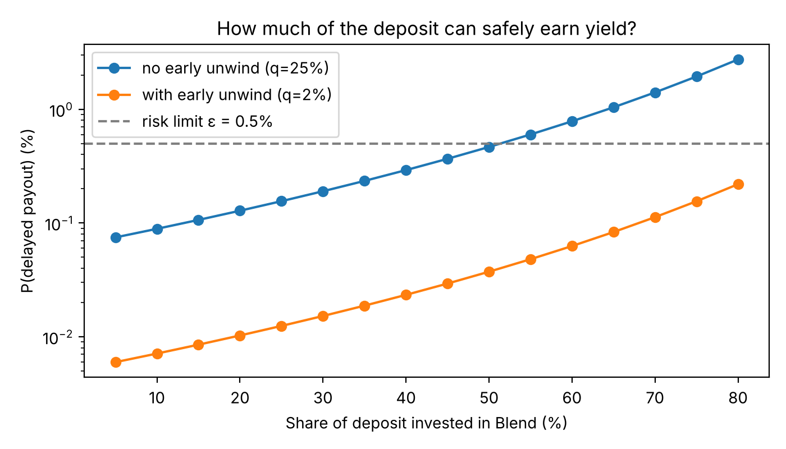

# Blendlord · Yield-Bearing Rental Deposits

**Rental deposits that earn yield, on Stellar.** A neutral Soroban contract holds the tenant's deposit in USDC. While the lease runs, the tenant can put up to 80% of it to work: directly in a [Blend](https://blend.capital) lending pool and/or in a shared [DeFindex](https://defindex.io) reserve vault whose exposure is managed by our risk model. At move-out, a fixed waterfall pays the landlord's agreed deduction first and returns everything else to the tenant, **yield included**.

> Built at **HackMeridian 2026** (Lisbon) · Genesis · **Stellar Composed** track: Soroban escrow + Blend lending pool + DeFindex vault + an off-chain risk model, working together on testnet.

| | |
|---|---|
| **Live app** | [blendlord.netlify.app](https://blendlord.netlify.app) |
| **Live agreement, earning now** (100 USDC · 80% invested · 50% Blend / 50% DeFindex · 60-day lease) | [`CAYD…4ERN` on stellar.expert](https://stellar.expert/explorer/testnet/contract/CAYD7CI37ASKCBKVPJ4XMEE6MLSRN6JNCAJ3H6DWWQ6ZCDOOQEJ34ERN) |
| **Completed agreement** (offer → fund → earn in Blend + DeFindex → deduction → release, landlord yield share 3%) | [`CBKF…YDAA` on stellar.expert](https://stellar.expert/explorer/testnet/contract/CBKF46ALDRFM6BXJWSKY375LFTEMPOU67XXNJQO6TJ4H6TPKI5WCYDAA) |
| Contract code (Wasm hash) | `95f3ab7dd7243a0008cb72f308ff43e2935b708d66426fa8e2bf65e840c0fd5b` |
| Blendlord DeFindex reserve vault | [`CDUL…QRDED`](https://stellar.expert/explorer/testnet/contract/CDULNJ6EKQJJRPPZIGZ3R4T2W3DVTDFQTAMX3RBVV3RII5JJAXZQRDED) |
| Tests | **48 unit tests**, all passing (`cargo test -p rental-deposit`) |
| Typical fee per action | **≈ 0.003 XLM** |
| Demo video · Pitch deck | _links added at submission_ |

---

## The problem

- **A deposit is dead money.** Tenants lock one or two months of rent for years and earn nothing.
- **Whoever holds the money decides.** At move-out, deductions are a negotiation where one side already has the cash.
- **Escrow alone fixes trust, not the idle money.** Existing escrows keep deposits safe but idle.

## The solution

1. **Offer** – The landlord creates the agreement on-chain with the terms that protect them: tenant, amount, lease end, neutral arbiter, and a small share of the *yield* (default 3%, max 5%) as an incentive to offer Blendlord.
2. **Fund** – The tenant reviews the terms and accepts them by depositing USDC. The tenant **chooses** how much to invest (≤ 80%, with a recommendation from our risk model) and where: Blend direct or the DeFindex reserve.
3. **Earn** – The contract supplies its share to Blend, deposits the rest of the invested part into the DeFindex vault, and keeps at least 20% liquid. The app shows where every dollar is and the yield, live.
4. **Settle** – The landlord proposes a deduction with evidence. The tenant accepts or disputes; a neutral arbiter resolves disputes. The contract brings the money home from both venues and pays with the waterfall.

> *Others hold deposits safely; we make them work, with explicit risk controls.*

**Who decides what.** The landlord sets what protects them (amount, dates, arbiter) and the contract guarantees a liquid buffer of at least 20% for their deduction. The tenant decides everything about their own yield: how much to invest and where. The model recommends; the contract enforces the limits.



---

## Why it is "Composed"

| Piece | Role |
|---|---|
| **Soroban contract** (`contracts/rental-deposit`) | Neutral escrow, state machine, waterfall, timeouts, risk limits |
| **Blend v2 lending pool** (testnet `TestnetV2`) | Direct source of yield: the contract is a pure lender (`Supply` / `Withdraw`, never borrows) |
| **DeFindex vault** (our own, created with the DeFindex factory) | Shared, managed reserve across agreements; fee receiver = platform |
| **Quant risk model** (`quant/`) | Recommends the invested share; manages the vault's exposure to Blend |
| **USDC** (Blend testnet USDC) | Stable unit for the deposit |
| **Stellar Scaffold + Freighter** (`app/`) | React app: each party signs only their own actions |

### Blend direct
- **Supply:** `token.approve(pool, amount)` then `pool.submit_with_allowance(self, self, self, [Supply])`.
- **Withdraw all:** a `Withdraw` request with `i128::MAX`; the contract checks the returned position is empty before treating the funds as withdrawn.
- **Live data:** position = bTokens × `b_rate`; supply APR computed from utilization with Blend's own interest-rate model.

### DeFindex: a risk-managed shared reserve
Putting money in DeFindex only to reach the same Blend pool would add nothing. What it adds is **management**:

- **Our own vault**, "Blendlord", created with the DeFindex factory on testnet, with a Blend USDC strategy, a fee on yield to the platform (created at 1%), and our rebalance-manager role.
- **One reserve shared by all agreements.** Each agreement holds vault shares (`deposit` / `withdraw`), and the vault decides how much of the pooled money sits idle versus invested.
- **The risk model rebalances it.** `quant/rebalance.py` reads Blend's utilization and the upcoming move-outs and calls the vault's `rebalance`:
  - Utilization ≤ 85% → up to 90% of the reserve invested. Between 85% and 94% → scaled down linearly. ≥ 94% → everything back to idle.
  - **Glide path:** when a lease in the reserve ends within 30 days, the reserve moves to idle ahead of the payout.
  - Verified on testnet: at 89.3% utilization the model invested 18.80 USDC (target 47%), then, with a lease ending in 10 days, unwound it all to idle.
- **Nested auth done right:** the contract authorizes the vault's token pull itself with `authorize_as_current_contract`, so the tenant signs only `fund` and their own transfer (covered by a test with real auth, `contract_authorizes_the_vault_pull_itself`).

> Honest note: on testnet the vault's strategy is the same Blend pool. The value of DeFindex here is the managed, shared reserve and the platform fee, not a second source of yield. On mainnet the vault can hold several strategies.

```bash
python quant/rebalance.py                               # dry run: state and plan
python quant/rebalance.py --execute                     # send the rebalance
python quant/rebalance.py --days-to-lease-end 10 --execute   # glide-path demo
```

---

## Guarantees enforced on-chain

| Rule | How |
|---|---|
| Neither party can take the deposit alone | Every payout follows the waterfall; each action requires the right signer |
| Both parties consent to the terms | Landlord signs the constructor; the tenant re-states the landlord's terms in `fund` (mismatch → reverts) |
| The tenant decides about their own yield | `fund` takes the tenant's invested share and Blend/DeFindex split |
| Nobody can front-run the set-up | Terms are fixed atomically at deployment (constructor) |
| At least 20% always stays liquid | `invest_bps ≤ 8000`, checked on-chain |
| The landlord's share is of the yield, never of the deposit | Waterfall: ① deduction ② rest of the deposit to the tenant ③ only what exceeds the deposit is split; `landlord_yield_bps ≤ 500` |
| Landlord never gets more than agreed | Deduction ≤ deposit; arbiter can only award **≤** what the landlord asked |
| Deductions are paid even if a venue is illiquid | Buffer pays first (landlord first). The rest waits in `Settling` and anyone can `claim_remaining` later |
| No settlement by silence before the lease ends | Landlord's 14-day timeout counts from `max(proposal, lease end)` |
| Nobody can hold the deposit hostage | Landlord never asks → full refund 14 days after lease end · arbiter silent → tenant settles with no deduction 30 days after `max(dispute, lease end)` |
| Settlement doesn't depend on the venues' liquidity that day | `unwind()`: anyone can bring funds home from Blend and DeFindex during the last 30 days |

### Contract interface

| Function | Signer | What it does |
|---|---|---|
| `__constructor(landlord, tenant, arbiter, token, pool, vault, amount, landlord_yield_bps, lease_end)` | Landlord | Creates the agreement with the landlord's terms (state `Offered`) |
| `fund(landlord, arbiter, token, pool, vault, amount, invest_bps, defindex_bps, landlord_yield_bps, lease_end)` | Tenant | Accepts the landlord's terms, sets the tenant's own invest share and split, deposits and invests |
| `cancel_offer()` | Landlord | Withdraws an unfunded offer |
| `decline_offer()` | Tenant | Says no to an offer, explicitly; nothing moves and the landlord can re-offer |
| `propose_deduction(amount, evidence)` | Landlord | Asks for a deduction (≤ deposit), with a link/hash to evidence |
| `accept_and_release()` | Tenant | Accepts and settles with the waterfall |
| `dispute()` | Tenant | Freezes the payout until the arbiter decides |
| `resolve(amount)` | Arbiter | Settles a dispute with a deduction ≤ the landlord's ask |
| `settle_after_arbiter_timeout()` | Tenant | Arbiter silent for 30 days → settles with no deduction |
| `finalize_deduction()` | Landlord | Tenant silent 14 days after proposal and lease end → settles with the proposal |
| `claim_full_refund()` | Tenant | Landlord never proposed, 14 days after lease end → full refund |
| `unwind()` | Anyone | Last 30 days of the lease: brings funds home from Blend and DeFindex |
| `claim_remaining()` | Anyone | Finishes a settlement once the venues have liquidity again |
| `extend_ttl()` | Anyone | Keeps the contract's storage alive during long leases |
| `get_deposit()` | — (read) | Full state for the app |

States: `Offered → Funded → DeductionProposed → (Disputed) → [Settling] → Closed` · an offer can also end as `Declined` (tenant) or `Closed` unfunded (landlord cancels)

---

## The quant layer: how much can safely earn yield?

Investing more means more yield for the tenant but less cash on hand at move-out. We pick the share with an explicit risk criterion instead of a guess.

A payout is only **delayed** if two things happen at once: the deduction is larger than the liquid buffer, **and** the venue can't return funds that day. Treating them as independent:

$$P(\text{delay}) = P(D > 1 - w)\cdot q \le \varepsilon$$

So the buffer is a **quantile** of the deduction distribution (the same idea as Value at Risk):

$$c^* = \text{quantile}_{1-\varepsilon/q}(D), \qquad w^* = \min(1 - c^*,\ 80\%)$$

`quant/monte_carlo.py` simulates **2 million leases** and cross-checks the simulation against the closed form (they agree to the second significant digit).

| Scenario (ε = 0.5%) | Safe share to invest | P(delay) at 70% | P(delay) at 80% |
|---|---|---|---|
| No early unwind (q = 25%) | **51%** | 1.41% ❌ | 2.74% ❌ |
| With `unwind()` (q = 2%) | **80%** (cap) | 0.11% ✅ | 0.22% ✅ |



**Early unwind isn't a detail:** it raises the safe share from 51% to 80%, lifting expected yield from ~2.5% to ~4% of the deposit per year at a 5% supply APR, at the same risk. In the app, the tenant sees the recommendation, the live delay probability for the share they choose, and the expected yield at Blend's **current** supply APR.

**q is live.** Blend refuses withdrawals that would push utilization past its cap, so the chance the venue can't pay rises when the pool is crowded. In the app, q is 2% while Blend is ≤ 85% borrowed and rises linearly to 25% at 94%, so the recommended share follows the pool: 80% at 80% utilization, 70% at 87%, 60% at 90%, 50% at ≥ 93.5% (same ε = 0.5%).

**Where to invest (Blend direct vs. the DeFindex reserve).** The model also recommends the split, using the same utilization bands as the rebalancer (`app/src/lib/split.ts`): with Blend comfortably liquid (≤ 85% borrowed) it recommends 20% DeFindex, mostly direct for the full rate; between 85% and 94% it moves linearly toward the reserve; at ≥ 94%, or when the lease ends within 30 days, it recommends 100% DeFindex, the reserve our model de-risks. The tenant sees the recommendation and the reason, and can apply it with one click.

The same idea drives the DeFindex reserve: `q` rises with Blend's utilization, so the rebalancer de-risks the shared reserve when the pool gets crowded and before move-outs.

**The model proposes; the contract constrains.** The model runs off-chain; the 80% cap and the waterfall are enforced on-chain.

**Assumptions (stated, to be calibrated):** 60% of leases end with no deduction; otherwise log-normal with median 12% of the deposit (σ = 0.85). In production, the distribution would be calibrated with real data from letting agencies and student residences, and q with the pool's utilization history.

---

## Security review

The contract went through **two independent reviews** (an isolated AI reviewer with no context on how it was built, and a second model). Every confirmed finding was fixed and turned into a regression test:

| Finding | Fix | Test |
|---|---|---|
| Landlord could propose early and finalize by silence mid-lease | Timeout counts from `max(proposal, lease end)` | `early_deduction_cannot_be_finalized_before_lease_end` |
| Disputed funds stuck forever if the arbiter disappears | `settle_after_arbiter_timeout` | `silent_arbiter_cannot_freeze_funds_forever` |
| Arbiter timeout could release the deposit mid-lease | Counts from `max(dispute, lease end)` | `early_dispute_cannot_release_the_deposit_mid_lease` |
| Agreement set-up could be front-run | Terms in the constructor; tenant re-states them in `fund` | `tenant_signature_commits_to_the_terms`, `creating_an_agreement_needs_the_landlords_signature` |
| A venue outage reverted the whole settlement | Buffer pays first; `Settling` + `claim_remaining` | `illiquid_blend_buffer_pays_now_rest_later`, `illiquid_vault_buffer_pays_blend_part_returns_rest_later` |
| Partial withdrawal could close with funds left in Blend | Check the returned position is empty | `partial_withdrawal_never_closes_with_funds_left_in_blend` |
| Timestamp overflow on extreme `lease_end` | Saturating math, 5-year cap, `overflow-checks` | `lease_end_is_bounded` |

New rules added after the reviews have their own tests too: `tenant_chooses_how_much_to_invest`, `tenant_chooses_the_split`, `landlord_gets_a_small_share_of_the_yield_only`, `no_yield_no_landlord_share`, `landlord_share_works_when_money_comes_back_in_two_steps`, `unwind_brings_both_venues_home`.

### Design decisions and known limitations

- **Early termination is allowed, but never by silence.** Before the lease ends, a settlement needs the tenant's acceptance or the neutral arbiter's ruling on a deduction the landlord raised (e.g. the tenant moves out early). Timeouts only apply after the lease ends.
- **Pool, vault, token and arbiter are verified in the app, not on-chain.** The landlord sets them at creation. The app blocks funding unless they are the official Blend pool, the Blendlord vault, a supported asset and the platform's arbiter. In production: a factory contract with an allow-list.
- **Single arbiter.** One neutral account (the platform) resolves disputes. In production: a multisig or an arbitration service.
- **Vault fee paused on testnet.** See the business model: an external account without a trustline made fee distribution revert, which also blocked rebalancing. Found while testing, fixed by the vault manager in two calls.
- **Rebalancer is off-chain.** `rebalance.py` holds the vault's rebalance-manager role; in production it runs as a keeper with monitoring.
- **Withdrawal is all-or-nothing per call.** If a venue can only return part of the position, `claim_remaining` waits until it can return the rest (the buffer has already paid out).
- **Losses.** If Blend ever had bad debt, the landlord is still paid first, so the yield and then the tenant's principal absorb it. Blend's backstop is the first line of defence. With no yield, the landlord's yield share is zero.
- **Rounding.** Blend rounds bTokens down and the vault rounds shares at entry, so with almost no elapsed time the tenant may receive a few stroops less than deposited.
- **"My agreements" is per device.** The app remembers the agreements you created or opened in that browser; an on-chain index (factory) would list them on any device.
- **Storage TTL.** A new contract lives for months; for longer leases a keeper calls `extend_ttl()`.

---

## Run it locally

Requirements: Rust + `wasm32v1-none` target, [Stellar CLI](https://developers.stellar.org/docs/tools/cli), `stellar-scaffold`, Node 20+, Python 3 and [Freighter](https://www.freighter.app/) on **Testnet**.

```bash
git clone https://github.com/ddortabencomo/yield-bearing-rental-deposit.git
cd yield-bearing-rental-deposit
npm install --ignore-scripts
STELLAR_NETWORK=testnet npm start          # PowerShell: $env:STELLAR_NETWORK="testnet"; npm start
```

Open http://localhost:5173. Use two Freighter accounts (landlord and tenant), funded with Friendbot. Both need Blend testnet USDC: on testnet.blend.capital, open a pool with your wallet connected and use the faucet banner. Then:

1. Landlord: **I own a home** → offer the terms (and your yield share)
2. Tenant: open the link → choose how much to invest and where → **Accept terms & lock deposit**
3. Watch where the deposit is and the yield; landlord proposes a deduction; tenant accepts or disputes

Contract tests and build:

```bash
cargo test -p rental-deposit                   # 48 tests
stellar contract build --package rental-deposit
python quant/monte_carlo.py                    # regenerates quant/curve.json and curve.png
```

### Testnet addresses

| | |
|---|---|
| Blend pool (TestnetV2) | `CCEBVDYM32YNYCVNRXQKDFFPISJJCV557CDZEIRBEE4NCV4KHPQ44HGF` |
| USDC (Blend testnet) | `CAQCFVLOBK5GIULPNZRGATJJMIZL5BSP7X5YJVMGCPTUEPFM4AVSRCJU` |
| Blendlord DeFindex vault | `CDULNJ6EKQJJRPPZIGZ3R4T2W3DVTDFQTAMX3RBVV3RII5JJAXZQRDED` |
| DeFindex Blend USDC strategy | `CALLOM5I7XLQPPOPQMYAHUWW4N7O3JKT42KQ4ASEEVBXDJQNJOALFSUY` |
| RentalDeposit Wasm hash | `95f3ab7dd7243a0008cb72f308ff43e2935b708d66426fa8e2bf65e840c0fd5b` |

> Note: testnet resource fees spiked during the hackathon (the same call cost 0.001 XLM or hundreds of XLM depending on the hour). The app wraps calls in a **fee-bump transaction** when the fee doesn't fit a regular transaction, like the Stellar CLI does.

## Repository structure

```
contracts/rental-deposit/   Soroban contract (lib.rs) and 48 tests (test.rs)
app/src/components/         RentalDeposit (agreement UI), QuantPanel (risk model UI)
app/src/lib/rental.ts       Contract, Blend and DeFindex calls, live rates, fee-bump sending
quant/                      Monte Carlo model (curve.json, curve.png) and rebalance.py (vault manager)
deploy/defindex/            Parameters used to create the Blendlord vault with the DeFindex factory
```

## Business model

- **Platform:** a 1% fee on the yield earned in the DeFindex reserve, collected on-chain by the vault (fee receiver = platform). Paid only when there is yield. *On testnet the fee is set to 0 for now: fee distribution also pays DeFindex's protocol fee account, which has no trustline for Blend's test USDC, so distributions reverted (`Error(Contract, #13)`). We set it with the vault's `lock_fees(0)` and returned the pending fees with `release_fees`; restoring it is `lock_fees(100)` once that account can receive the asset.*
- **Landlords and agencies:** an agreed share of the yield (default 3%, capped at 5% on-chain), the incentive to offer Blendlord instead of a classic deposit.
- **Tenants:** keep at least 95% of the yield and 100% of their deposit minus agreed deductions.

## Next steps

- **Factory contract** with an allow-list of pools, vaults and assets, and agreement indexing, so a tenant connects their wallet and sees their pending offers (today the landlord shares a link)
- **Mid-lease claims with top-ups:** today a deposit is settled once, at move-out, as in the real world. Next, the landlord can claim during the lease (with the tenant's consent or the arbiter's ruling) and the tenant tops the deposit back up, so the guarantee stays whole and the agreement keeps running
- **Multi-strategy reserve:** more strategies in the DeFindex vault, allocated with the same risk budget (maximize Σ wᵢrᵢ − λ·riskᵢ)
- **Rebalancer as a keeper** with monitoring, reading move-out dates directly from the agreements
- **Calibrate the model** with real deduction data from agencies and student residences
- **Arbitration** via multisig or an arbitration partner; build on existing escrow providers (e.g. Trustless Work) as the custody layer
- **Regulatory fit:** where deposits must be lodged with a public body (e.g. Spain's regional deposit registries), offer the product to agencies as a compliant custody option

---

*Built in 27 hours at HackMeridian 2026. Testnet only: not audited, not for real funds.*
