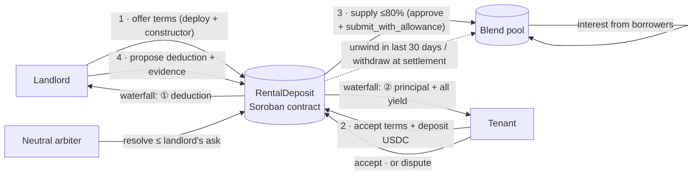

# Yield-Bearing Rental Deposits

**Rental deposits that earn yield, on Stellar.** A neutral Soroban contract holds the tenant's deposit in USDC. While the lease runs, up to 80% of it earns interest in a [Blend](https://blend.capital) lending pool. At move-out, a fixed waterfall pays the landlord's agreed deduction first and returns everything else to the tenant, **yield included**.

> Built at **HackMeridian 2026** (Lisbon) · Genesis · **Stellar Composed** track: Soroban escrow + Blend lending pools + an off-chain risk model, working together on testnet.

| | |
|---|---|
| **Live agreement on testnet** (full lifecycle: offer → fund → earn → unwind → deduction → release) | [`CAUS…WD2R` on stellar.expert](https://stellar.expert/explorer/testnet/contract/CAUS4P47QJ4Y6L4NSAB45PUFOWLAFNMNHUGW6G2UCRTD3LCWH2ETWD2R) |
| Settlement transaction (fee: **0.0011 XLM**) | [`840dff…f5b2`](https://stellar.expert/explorer/testnet/tx/840dff429b743145e21d1fe106533fde92c6015f82770e97d2e35966b2b4f5b2) |
| Contract code (Wasm hash) | `0853eb87a72d829e78502c214874919c4af18c3b0dfbab2a71a7e26323c94537` |
| Tests | **30 unit tests**, all passing (`cargo test -p rental-deposit`) |
| Demo video · Pitch deck | _links added at submission_ |

---

## The problem

- **A deposit is dead money.** Tenants lock one or two months of rent for years and earn nothing.
- **Whoever holds the money decides.** At move-out, deductions are a negotiation where one side already has the cash.
- **Escrow alone fixes trust, not the idle money.** Existing escrows keep deposits safe but idle.

## The solution

1. **Offer** – The landlord creates the agreement on-chain with its terms: tenant, amount, share to invest (≤ 80%), lease end and a neutral arbiter.
2. **Fund** – The tenant reviews the terms in the app and accepts them by depositing USDC. Their signature commits to exactly those terms.
3. **Earn** – The contract supplies the invested share to a Blend pool and keeps the rest as a liquid buffer. The app shows the yield live, read from Blend.
4. **Settle** – The landlord proposes a deduction with evidence. The tenant accepts or disputes; a neutral arbiter resolves disputes. The contract withdraws from Blend and pays with the waterfall.

> *Others hold deposits safely; we make them work, with explicit risk controls.*



---

## Why it is "Composed"

| Piece | Role |
|---|---|
| **Soroban contract** (`contracts/rental-deposit`) | Neutral escrow, state machine, waterfall, timeouts, risk limits |
| **Blend v2 lending pool** (testnet `TestnetV2`) | Source of yield: the contract is a pure lender (`Supply` / `Withdraw`, never borrows) |
| **USDC** (Blend testnet USDC, Stellar Asset Contract) | Stable unit for the deposit |
| **Quant risk model** (`quant/`) | Sets how much can be invested; the contract enforces the hard cap |
| **Stellar Scaffold + Freighter** (`app/`) | React app: each party signs only their own actions |

Blend integration details:
- **Supply:** `token.approve(pool, invested)` then `pool.submit_with_allowance(self, self, self, [Supply])`. This avoids nested-auth issues when one contract pays another.
- **Withdraw all:** a `Withdraw` request with `i128::MAX`. Verified on testnet that Blend caps it at the position. The contract then checks the returned position is empty before treating the funds as withdrawn.
- **Live data in the app:** the position is bTokens × `b_rate`, and the supply APR is computed from the pool's utilization with Blend's own interest-rate model.

---

## Guarantees enforced on-chain

| Rule | How |
|---|---|
| Neither party can take the deposit alone | Every payout follows the waterfall; each action requires the right signer |
| Both parties consent to the terms | Landlord signs the constructor; the tenant re-states the terms in `fund` (mismatch → reverts) |
| Nobody can front-run the set-up | Terms are fixed atomically at deployment (constructor) |
| Landlord never gets more than agreed | Deduction ≤ deposit; arbiter can only award **≤** what the landlord asked |
| At most 80% is invested | `invest_bps ≤ 8000`, checked on-chain |
| Deductions are paid even if Blend is illiquid | Buffer pays first (landlord first). The rest waits in `Settling` and anyone can `claim_remaining` later |
| No settlement by silence before the lease ends | Landlord's 14-day timeout counts from `max(proposal, lease end)` |
| Nobody can hold the deposit hostage | Landlord never asks → full refund 14 days after lease end · arbiter silent → tenant settles with no deduction 30 days after `max(dispute, lease end)` |
| Settlement doesn't depend on Blend's liquidity that day | `unwind()`: anyone can pull funds out of Blend during the last 30 days |

### Contract interface

| Function | Signer | What it does |
|---|---|---|
| `__constructor(landlord, tenant, arbiter, token, pool, amount, invest_bps, lease_end)` | Landlord | Creates the agreement with its terms (state `Offered`) |
| `fund(landlord, arbiter, token, pool, amount, invest_bps, lease_end)` | Tenant | Accepts the exact terms, deposits, supplies the invested share to Blend |
| `cancel_offer()` | Landlord | Withdraws an unfunded offer |
| `propose_deduction(amount, evidence)` | Landlord | Asks for a deduction (≤ deposit), with a link/hash to evidence |
| `accept_and_release()` | Tenant | Accepts and settles with the waterfall |
| `dispute()` | Tenant | Freezes the payout until the arbiter decides |
| `resolve(amount)` | Arbiter | Settles a dispute with a deduction ≤ the landlord's ask |
| `settle_after_arbiter_timeout()` | Tenant | Arbiter silent for 30 days → settles with no deduction |
| `finalize_deduction()` | Landlord | Tenant silent 14 days after proposal and lease end → settles with the proposal |
| `claim_full_refund()` | Tenant | Landlord never proposed, 14 days after lease end → full refund |
| `unwind()` | Anyone | Last 30 days of the lease: pulls funds out of Blend |
| `claim_remaining()` | Anyone | Finishes a settlement once Blend has liquidity again |
| `extend_ttl()` | Anyone | Keeps the contract's storage alive during long leases |
| `get_deposit()` | — (read) | Full state for the app |

States: `Offered → Funded → DeductionProposed → (Disputed) → [Settling] → Closed`

---

## The quant layer: how much can safely earn yield?

Investing more means more yield for the tenant but less cash on hand at move-out. We pick the share with an explicit risk criterion instead of a guess.

A payout is only **delayed** if two things happen at once: the deduction is larger than the liquid buffer, **and** Blend can't return funds that day. Treating them as independent:

$$P(\text{delay}) = P(D > 1 - w)\cdot q \le \varepsilon$$

So the buffer is a **quantile** of the deduction distribution (the same idea as Value at Risk):

$$c^* = \text{quantile}_{1-\varepsilon/q}(D), \qquad w^* = \min(1 - c^*,\ 80\%)$$

`quant/monte_carlo.py` simulates **2 million leases** and cross-checks the simulation against the closed form (they agree to the second significant digit).

| Scenario (ε = 0.5%) | Safe share to invest | P(delay) at 70% | P(delay) at 80% |
|---|---|---|---|
| No early unwind (q = 25%) | **51%** | 1.41% ❌ | 2.74% ❌ |
| With `unwind()` (q = 2%) | **80%** (cap) | 0.11% ✅ | 0.22% ✅ |


**Early unwind isn't a detail:** it raises the safe share from 51% to 80%, lifting expected yield from ~2.5% to ~4% of the deposit per year at a 5% supply APR, at the same risk. In the app, the landlord's offer form and the tenant's review screen show the recommendation, the live delay probability for the chosen share, and the expected yield at Blend's **current** supply APR (≈3.4–3.8% on testnet USDC, with ~79% of the pool borrowed).

**The model proposes; the contract constrains.** The model runs off-chain; the 80% cap is enforced on-chain.

**Assumptions (stated, to be calibrated):** 60% of leases end with no deduction; otherwise log-normal with median 12% of the deposit (σ = 0.85). In production, the distribution would be calibrated with real data from letting agencies and student residences, and q with the pool's utilization history.

---

## Security review

The contract went through **two independent reviews** (an isolated AI reviewer with no context on how it was built, and a second model). Every confirmed finding was fixed and turned into a regression test:

| Finding | Fix | Test |
|---|---|---|
| Landlord could propose early and finalize by silence mid-lease | Timeout counts from `max(proposal, lease end)` | `early_deduction_cannot_be_finalized_before_lease_end` |
| Disputed funds stuck forever if the arbiter disappears | `settle_after_arbiter_timeout` | `silent_arbiter_cannot_freeze_funds_forever` |
| Arbiter timeout could release the deposit mid-lease | Counts from `max(dispute, lease end)` | `early_dispute_cannot_release_the_deposit_mid_lease` |
| Agreement set-up could be front-run | Terms in the constructor; tenant re-states them in `fund` | `tenant_signature_commits_to_the_terms`, `creating_an_agreement_needs_the_landlords_signature` |
| A Blend outage reverted the whole settlement | Buffer pays first; `Settling` + `claim_remaining` | `illiquid_blend_buffer_pays_now_rest_later`, `illiquid_blend_big_deduction_landlord_first` |
| Partial withdrawal could close with funds left in Blend | Check the returned position is empty | `partial_withdrawal_never_closes_with_funds_left_in_blend` |
| Timestamp overflow on extreme `lease_end` | Saturating math, 5-year cap, `overflow-checks` | `lease_end_is_bounded` |

### Design decisions and known limitations

- **Early termination is allowed, but never by silence.** Before the lease ends, a settlement needs the tenant's acceptance or the neutral arbiter's ruling on a deduction the landlord raised (e.g. the tenant moves out early). Timeouts only apply after the lease ends.
- **Pool and token are verified in the app, not on-chain.** The landlord chooses them at creation. The app blocks funding unless they are the official Blend pool and a supported asset. In production: a factory contract with an allow-list.
- **Single arbiter.** One neutral account (the platform) resolves disputes. In production: a multisig or an arbitration service.
- **Withdrawal is all-or-nothing per call.** If Blend can only return part of the position, `claim_remaining` waits until it can return the rest (the buffer has already paid out).
- **Blend losses.** If the pool ever had bad debt, the landlord is still paid first, so the yield and then the tenant's principal absorb it. Blend's backstop is the first line of defence.
- **Rounding.** Blend rounds bTokens down; with almost no elapsed time, the tenant may receive 1 stroop less.
- **Storage TTL.** A new contract lives for months; for longer leases a keeper calls `extend_ttl()` (cheap, only pays when needed).

---

## Run it locally

Requirements: Rust + `wasm32v1-none` target, [Stellar CLI](https://developers.stellar.org/docs/tools/cli), `stellar-scaffold`, Node 20+, and [Freighter](https://www.freighter.app/) on **Testnet**.

```bash
git clone https://github.com/ddortabencomo/yield-bearing-rental-deposit.git
cd yield-bearing-rental-deposit
npm install --ignore-scripts
STELLAR_NETWORK=testnet npm start          # PowerShell: $env:STELLAR_NETWORK="testnet"; npm start
```

Open http://localhost:5173. Use two Freighter accounts (landlord and tenant), funded with Friendbot. Both need Blend testnet USDC: on testnet.blend.capital, open a pool with your wallet connected and use the faucet banner. Then:

1. Landlord: **+ New agreement** → offer the terms
2. Tenant: open the link → **Accept terms & lock deposit**
3. Watch the yield, optionally **Unwind**; landlord proposes a deduction; tenant accepts or disputes

Contract tests and build:

```bash
cargo test -p rental-deposit                   # 30 tests
stellar contract build --package rental-deposit
python quant/monte_carlo.py                    # regenerates quant/curve.json and curve.png
```

### Testnet addresses

| | |
|---|---|
| Blend pool (TestnetV2) | `CCEBVDYM32YNYCVNRXQKDFFPISJJCV557CDZEIRBEE4NCV4KHPQ44HGF` |
| USDC (Blend testnet) | `CAQCFVLOBK5GIULPNZRGATJJMIZL5BSP7X5YJVMGCPTUEPFM4AVSRCJU` |
| RentalDeposit Wasm hash | `0853eb87a72d829e78502c214874919c4af18c3b0dfbab2a71a7e26323c94537` |

> Note: testnet resource fees spiked during the hackathon (the same call cost 0.001 XLM or hundreds of XLM depending on the hour). The app wraps calls in a **fee-bump transaction** when the fee doesn't fit a regular transaction, like the Stellar CLI does.

## Repository structure

```
contracts/rental-deposit/   Soroban contract (lib.rs) and 30 tests (test.rs)
app/src/components/         RentalDeposit (agreement UI), QuantPanel (risk model UI)
app/src/lib/rental.ts       Contract + Blend calls, live rates, fee-bump sending
quant/                      Monte Carlo model, curve.json, curve.png
```

## Next steps

- **Factory contract** with an allow-list of pools and assets, and agreement indexing
- **Multi-pool allocation:** maximize Σ wᵢrᵢ − λ·riskᵢ with per-pool caps, using the same risk budget
- **Calibrate the model** with real deduction data from agencies and student residences
- **Arbitration** via multisig or an arbitration partner; build on existing escrow providers (e.g. Trustless Work) as the custody layer
- **Regulatory fit:** where deposits must be lodged with a public body (e.g. Spain's regional deposit registries), offer the product to agencies as a compliant custody option
- **Business model:** a small share of the yield, paid only when there is yield

---

*Built in 27 hours at HackMeridian 2026. Testnet only: not audited, not for real funds.*
